# 基于Springboot的在线政务服务中心--论文

> 🎓 **计算机毕业设计 · 基于Springboot的在线政务服务中心--论文**
>
> 本仓库只放**项目介绍 + 运行截图**（截图是站点带水印的原图，存在仓库 `images/` 里）。
>
> 👉 **完整可运行源码 / 数据库脚本 / 部署文档：[点我获取](https://geekcode.top/archives/%E5%9F%BA%E4%BA%8ESpringboot%E7%9A%84%E5%9C%A8%E7%BA%BF%E6%94%BF%E5%8A%A1%E6%9C%8D%E5%8A%A1%E4%B8%AD%E5%BF%83-%E8%AE%BA%E6%96%87?utm_source=github)**
>
> 💬 咨询微信：**ir9372**　|　🌐 更多项目：[极客代码 geekcode.top](https://geekcode.top/?utm_source=github)
>
> 📌 项目详情页：<https://geekcode.top/archives/%E5%9F%BA%E4%BA%8ESpringboot%E7%9A%84%E5%9C%A8%E7%BA%BF%E6%94%BF%E5%8A%A1%E6%9C%8D%E5%8A%A1%E4%B8%AD%E5%BF%83-%E8%AE%BA%E6%96%87?utm_source=github>

<table><td width="230" align="center"> <b>扫码加微信 ir9372</b></td><td valign="middle">📦 源码 = 项目介绍 + 全部运行截图 + 数据库 + 部署文档 👉 点上方任意截图，直接跳到 <b>极客代码 geekcode.top</b> 详情页</td></table>

---

<h1>基于Springboot的在线政务服务中心--论文</h1>
<h2>项目概述</h2>

本项目旨在构建一个基于 Spring Boot 框架的在线政务服务中心系统，致力于解决传统政务服务中信息分散、办事流程繁琐及用户交互不便等问题。系统采用前后端分离架构，核心功能涵盖证件查询、教育培训、便民服务、交流论坛、通知公告及投诉建议等模块，实现了政务信息的集中展示与高效检索。适用人群主要包括需要办理各类政务事项的社会公众以及负责后台数据维护与业务审核的政府管理人员。技术架构上，后端依托 Spring Boot 提供稳定的 RESTful API 服务，集成 MyBatis-Plus 进行持久层操作，并使用 Shiro 实现权限控制；前端通过 Vue 框架构建用户界面，确保了良好的用户体验与系统响应速度。该系统不仅提升了政务服务的透明度与便捷性，也为数字化政府建设提供了可行的技术解决方案。

<h2>技术架构</h2>

本系统采用经典的前后端分离架构设计，以确保系统的可维护性、扩展性及高并发处理能力。

<strong>1. 后端架构</strong>
后端基于 Java 语言开发，核心框架选用 Spring Boot，利用其自动配置和起步依赖特性简化开发流程。持久层采用 MyBatis-Plus，在 MyBatis 的基础上增强了 CRUD 操作效率，支持条件构造器与代码生成器，大幅减少了样板代码。安全认证与授权模块集成 Apache Shiro，用于处理用户登录状态维持、角色权限校验及会话管理。数据库选用 MySQL，通过 JDBC 驱动连接，确保数据存储的一致性与可靠性。此外，引入 Protobuf 用于高性能序列化通信，Commons-Lang3 提供基础工具类支持。

<strong>2. 前端架构</strong>
前端采用 Vue.js 框架构建单页面应用（SPA），结合 Element UI 或类似组件库实现快速界面搭建。通过 Axios 发起 HTTP 请求与后端接口进行数据交互，实现了视图与数据的动态绑定。路由管理使用 Vue Router，确保前台用户端与后台管理端的页面跳转逻辑清晰。

<strong>3. 核心技术选型理由</strong>

<ul>
<li><strong>Spring Boot</strong>: 生态成熟，社区活跃，能够快速集成各种中间件，适合构建企业级微服务或单体应用。</li>
<li><strong>MyBatis-Plus</strong>: 相比原生 MyBatis，提供了更丰富的通用 Mapper 和分页插件，降低了 SQL 编写复杂度，提高了开发效率。</li>
<li><strong>Shiro</strong>: 轻量级且易于理解的安全框架，能够灵活应对复杂的权限需求，如按钮级权限控制和资源访问保护。</li>
<li><strong>Vue.js</strong>: 渐进式 JavaScript 框架，组件化开发模式有利于大型项目的模块化拆分与维护。</li>
</ul>

<a href="https://geekcode.top/archives/%E5%9F%BA%E4%BA%8ESpringboot%E7%9A%84%E5%9C%A8%E7%BA%BF%E6%94%BF%E5%8A%A1%E6%9C%8D%E5%8A%A1%E4%B8%AD%E5%BF%83-%E8%AE%BA%E6%96%87?utm_source=github" title="查看完整源码">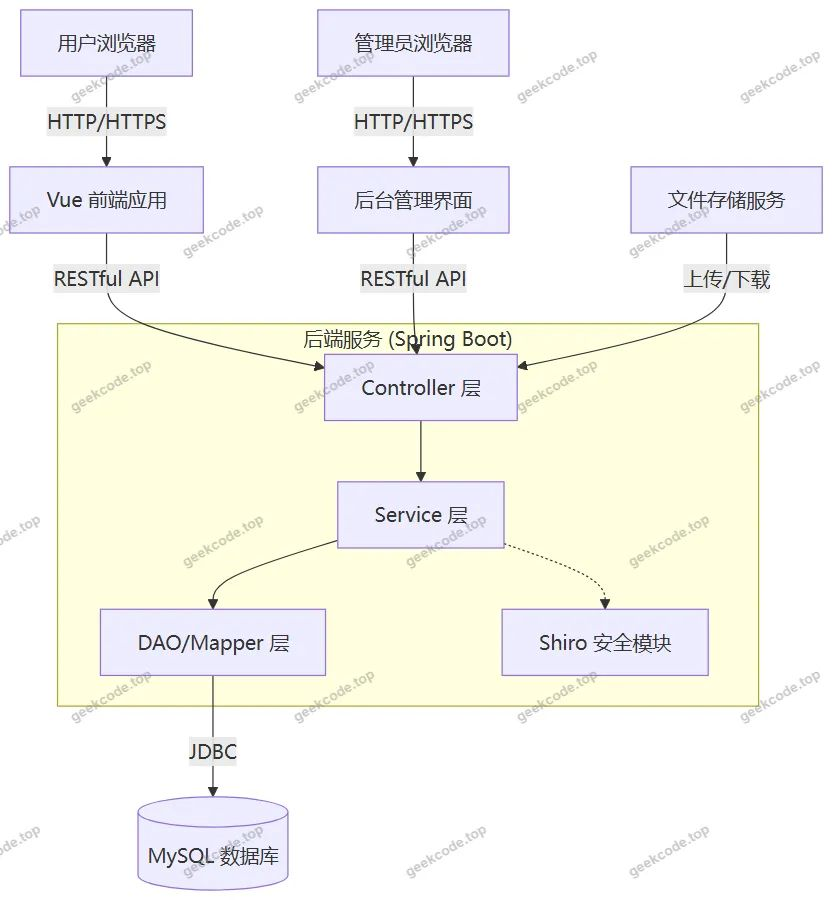</a>

<h2>功能模块</h2>

根据源码结构与截图所示，系统分为前台用户服务门户与后台管理系统两大板块。

<h3>前台用户端</h3>

前台主要面向普通市民，提供政务信息查询与服务办理入口。

<ol>
<li><strong>首页与导航</strong>：展示系统核心入口，包括证件查询、教育培训、便民服务、交流论坛、通知公告、投诉建议等一级菜单。</li>
<li><strong>证件查询</strong>：提供证件信息的检索功能，支持列表展示与详情查看。</li>
<li><strong>教育培训</strong>：展示政府提供的培训课程信息，包含课程列表与详细内容。</li>
<li><strong>便民服务</strong>：列出各类便民服务项目，方便用户查找附近或可用的服务资源。</li>
<li><strong>交流论坛</strong>：提供用户互动平台，支持发帖、回帖及查看论坛列表。</li>
<li><strong>通知公告</strong>：发布最新的政府公告与通知信息，支持列表浏览。</li>
<li><strong>投诉建议</strong>：允许用户提交对政务服务的意见与建议，并查看相关记录。</li>
<li><strong>个人中心</strong>：虽然菜单显示为空，但截图中存在“前台-个人中心”、“前台-收藏列表”、“前台-认证申请”等功能页面，表明用户可查看个人信息、收藏内容及管理自己的认证申请状态。</li>
<li><strong>其他列表页</strong>：包括关于我们、查询信息、代缴服务等内容的展示列表。</li>
</ol>
<h3>后台管理端</h3>

后台面向管理员，提供全面的数据管理与系统配置功能。

<ol>
<li><strong>登录与安全</strong>：管理员登录页面，集成身份验证机制。</li>
<li><strong>在线客服</strong>：实时聊天窗口，用于处理用户咨询与反馈。</li>
<li><strong>认证申请管理</strong>：审核用户提交的实名认证或其他资质申请材料。</li>
<li><strong>系统首页</strong>：展示关键数据统计概览。</li>
<li><strong>内容管理模块</strong>：</li>
</ol>
<ul>
<li><strong>通知公告</strong>：增删改查公告信息。</li>
<li><strong>便民服务</strong>：管理服务项目内容与分类。</li>
<li><strong>教育培训</strong>：维护课程信息与报名规则。</li>
<li><strong>关于我们</strong>：编辑机构简介与联系方式。</li>
<li><strong>系统简介</strong>：配置系统介绍文案。</li>
<li><strong>轮播图管理</strong>：上传与管理首页轮播图片。</li>
</ul>
<ol start="6">
<li><strong>业务数据处理</strong>：</li>
</ol>
<ul>
<li><strong>投诉建议</strong>：查看并回复用户的投诉与建议。</li>
<li><strong>证件查询</strong>：维护证件数据库信息。</li>
<li><strong>查询信息</strong>：管理通用查询数据源。</li>
<li><strong>代缴服务</strong>：配置和管理代缴业务项。</li>
<li><strong>交流论坛</strong>：审核帖子、删除违规内容、管理版块。</li>
</ul>
<ol start="7">
<li><strong>用户与权限管理</strong>：</li>
</ol>
<ul>
<li><strong>用户管理</strong>：查看注册用户信息，禁用异常账号。</li>
<li><strong>管理员管理</strong>：添加或删除后台管理员账号，分配角色权限。</li>
</ul>
<ol start="8">
<li><strong>系统配置</strong>：全局参数设置，如网站标题、版权信息等。</li>
</ol>
<h2>用户角色与权限</h2>

系统主要包含两类用户角色，通过 Shiro 框架进行权限隔离与控制。

<strong>1. 普通用户（前台用户）</strong>

<ul>
<li><strong>注册与登录</strong>：拥有个人账号，可进行身份认证。</li>
<li><strong>信息浏览</strong>：有权访问所有公开的前台模块，如通知公告、便民服务、教育培训、证件查询等。</li>
<li><strong>互动参与</strong>：可在交流论坛发帖、评论；在投诉建议模块提交意见。</li>
<li><strong>个人管理</strong>：可管理个人资料、查看我的收藏列表、跟踪我的认证申请状态。</li>
<li><strong>限制</strong>：无法访问后台管理功能，无法修改公共数据。</li>
</ul>

<strong>2. 系统管理员（后台用户）</strong>

<ul>
<li><strong>超级权限</strong>：拥有后台所有模块的操作权限。</li>
<li><strong>内容维护</strong>：可对通知公告、便民服务、教育培训、关于我们、系统简介等内容进行新增、修改、删除操作。</li>
<li><strong>业务审核</strong>：负责审核用户的认证申请，处理投诉建议，管理论坛帖子。</li>
<li><strong>用户管理</strong>：可以查看、编辑或删除前台注册用户的信息，管理其他管理员账号。</li>
<li><strong>系统配置</strong>：有权修改轮播图、系统全局配置参数。</li>
<li><strong>客服沟通</strong>：可通过在线客服模块与前台用户直接对话。</li>
</ul>
<h2>项目特色与创新点</h2>

<strong>1. 全流程闭环政务服务体验</strong>
系统不仅提供静态的信息展示（如公告、简介），还集成了动态的业务交互功能（如认证申请、投诉建议、在线客服）。特别是“认证申请”与“后台审核”的联动，实现了从用户提交材料到管理员审批的完整业务闭环，提升了政务办理的线上化程度。

<strong>2. 多维度的信息公开与互动机制</strong>
除了传统的单向信息发布，项目引入了“交流论坛”和“投诉建议”模块，构建了双向沟通渠道。这种设计有助于收集社情民意，增强政府与民众之间的信任与互动，体现了服务型政府的理念。

<strong>3. 灵活的后台内容管理体系</strong>
后台涵盖了从基础资料（关于我们、系统简介）到具体业务数据（证件查询、代缴服务）的全方位管理接口。通过 MyBatis-Plus 的高效映射，管理员可以快速更新各类政务信息，确保前台展示的时效性与准确性。

<strong>4. 安全性与规范性并重</strong>
采用 Shiro 进行细粒度的权限控制，确保不同角色的数据隔离。同时，系统设计了专门的“在线客服”模块，为突发状况或复杂问题提供即时人工干预通道，弥补了自动化系统在灵活性上的不足。

<h2>部署环境</h2>

为确保系统正常运行，需准备以下软硬件环境：

<strong>1. 硬件环境</strong>

<ul>
<li>CPU: Intel Core i5 及以上或同等性能处理器</li>
<li>内存: 8GB RAM 及以上</li>
<li>硬盘: 至少 50GB 可用存储空间</li>
</ul>

<strong>2. 软件环境</strong>

<ul>
<li><strong>操作系统</strong>: Windows 10/11, Linux (CentOS 7+, Ubuntu 18.04+) 或 macOS</li>
<li><strong>Java 运行环境</strong>: JDK 1.8 或更高版本（推荐 JDK 1.8，因 Spring Boot 早期版本兼容性最佳）</li>
<li><strong>数据库</strong>: MySQL 5.7 或 MySQL 8.0</li>
<li><strong>Web 服务器</strong>: Nginx (用于反向代理和静态资源托管) 或 Tomcat (若内嵌容器未启用独立部署)</li>
<li><strong>Node.js</strong>: v14.x 或 v16.x (用于前端 Vue 项目的编译与打包)</li>
<li><strong>包管理工具</strong>: Maven 3.6+ (用于后端依赖管理), npm/yarn (用于前端依赖管理)</li>
</ul>

<strong>3. 开发工具（可选，用于二次开发）</strong>

<ul>
<li>IDE: IntelliJ IDEA 或 Eclipse</li>
<li>数据库客户端: Navicat for MySQL 或 DBeaver</li>
<li>接口测试: Postman</li>
</ul>
<h2>五、技术特性</h2>
<ul>
<li>前后端集成部署，前端资源打包至后端 static 目录</li>
<li>使用 MyBatis-Plus 简化数据访问层开发</li>
<li>集成 Shiro 权限框架实现角色权限控制</li>
</ul>
<h2>六、功能模块截图</h2>
<h3>前台用户端</h3>
<h4>前台-便民服务列表</h4>

<a href="https://geekcode.top/archives/%E5%9F%BA%E4%BA%8ESpringboot%E7%9A%84%E5%9C%A8%E7%BA%BF%E6%94%BF%E5%8A%A1%E6%9C%8D%E5%8A%A1%E4%B8%AD%E5%BF%83-%E8%AE%BA%E6%96%87?utm_source=github" title="查看完整源码">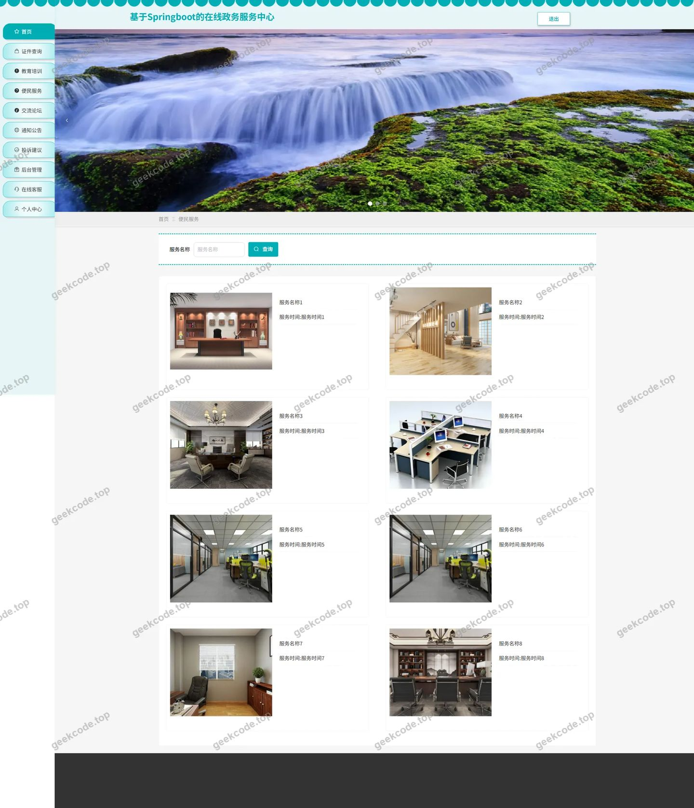</a>

<h4>前台-查询信息列表</h4>

<a href="https://geekcode.top/archives/%E5%9F%BA%E4%BA%8ESpringboot%E7%9A%84%E5%9C%A8%E7%BA%BF%E6%94%BF%E5%8A%A1%E6%9C%8D%E5%8A%A1%E4%B8%AD%E5%BF%83-%E8%AE%BA%E6%96%87?utm_source=github" title="查看完整源码">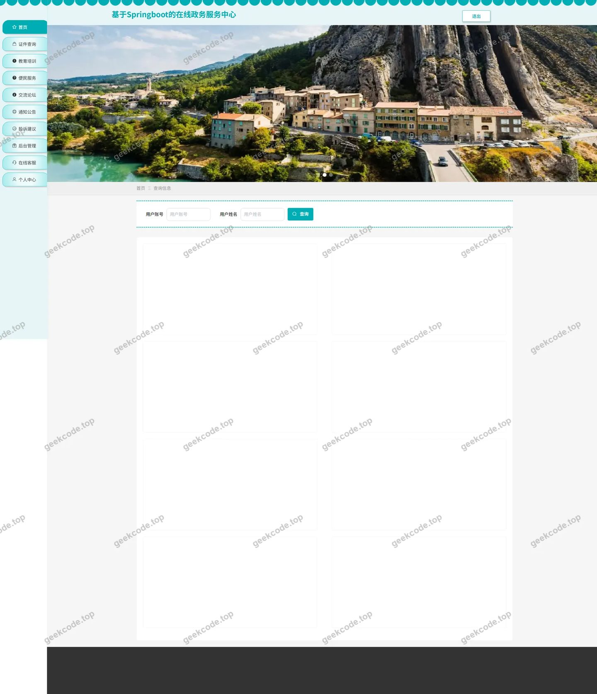</a>

<h4>前台-代缴服务列表</h4>

<a href="https://geekcode.top/archives/%E5%9F%BA%E4%BA%8ESpringboot%E7%9A%84%E5%9C%A8%E7%BA%BF%E6%94%BF%E5%8A%A1%E6%9C%8D%E5%8A%A1%E4%B8%AD%E5%BF%83-%E8%AE%BA%E6%96%87?utm_source=github" title="查看完整源码">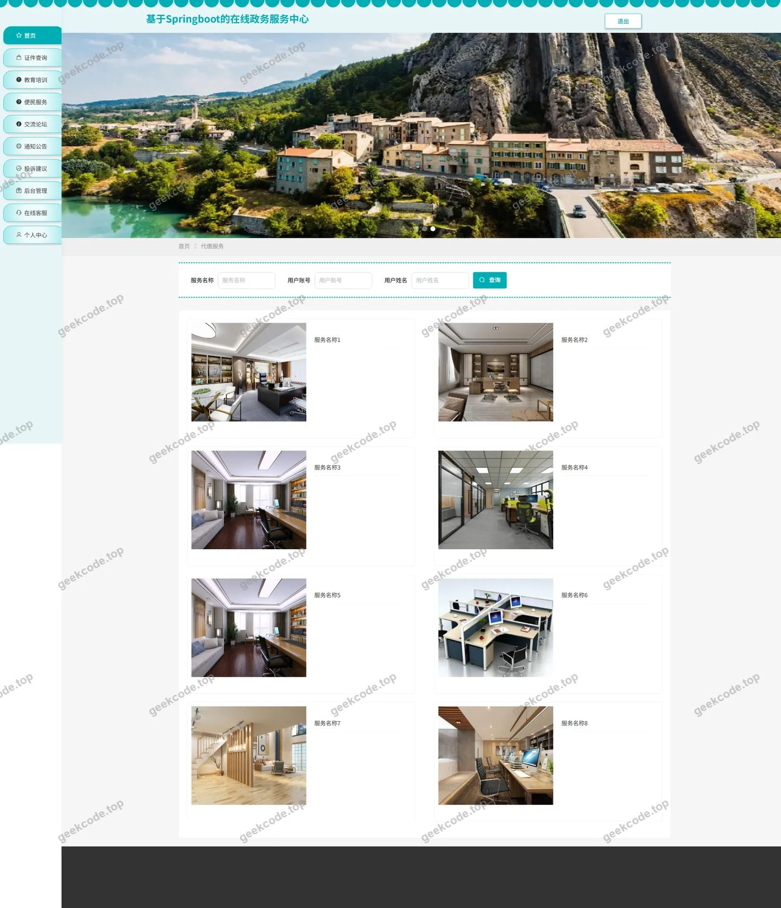</a>

<h4>前台-交流论坛列表</h4>

<a href="https://geekcode.top/archives/%E5%9F%BA%E4%BA%8ESpringboot%E7%9A%84%E5%9C%A8%E7%BA%BF%E6%94%BF%E5%8A%A1%E6%9C%8D%E5%8A%A1%E4%B8%AD%E5%BF%83-%E8%AE%BA%E6%96%87?utm_source=github" title="查看完整源码">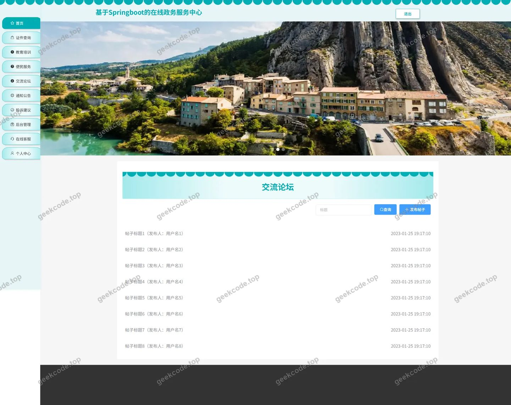</a>

<h4>前台-教育培训列表</h4>

<h4>前台-投诉建议列表</h4>

<a href="https://geekcode.top/archives/%E5%9F%BA%E4%BA%8ESpringboot%E7%9A%84%E5%9C%A8%E7%BA%BF%E6%94%BF%E5%8A%A1%E6%9C%8D%E5%8A%A1%E4%B8%AD%E5%BF%83-%E8%AE%BA%E6%96%87?utm_source=github" title="查看完整源码">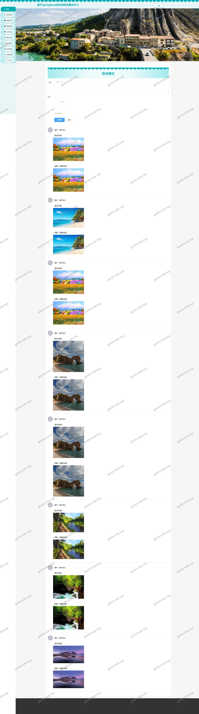</a>

<h4>前台-认证申请列表</h4>

<h4>前台-收藏列表</h4>

<a href="https://geekcode.top/archives/%E5%9F%BA%E4%BA%8ESpringboot%E7%9A%84%E5%9C%A8%E7%BA%BF%E6%94%BF%E5%8A%A1%E6%9C%8D%E5%8A%A1%E4%B8%AD%E5%BF%83-%E8%AE%BA%E6%96%87?utm_source=github" title="查看完整源码">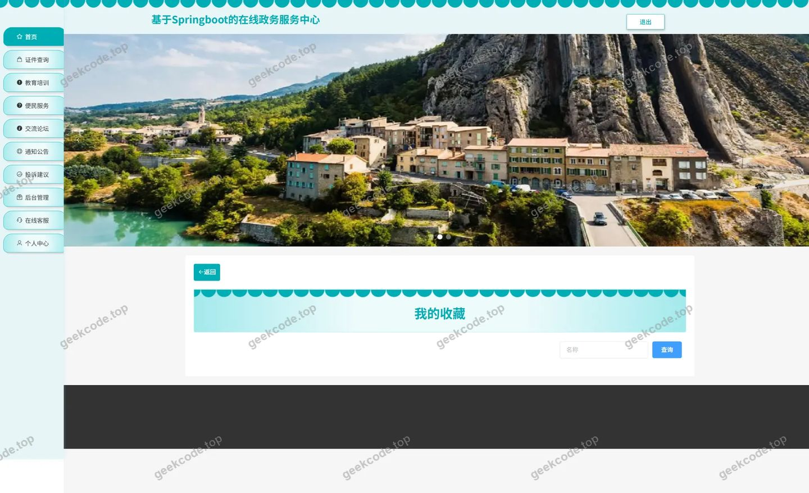</a>

<h4>前台-证件查询列表</h4>

<a href="https://geekcode.top/archives/%E5%9F%BA%E4%BA%8ESpringboot%E7%9A%84%E5%9C%A8%E7%BA%BF%E6%94%BF%E5%8A%A1%E6%9C%8D%E5%8A%A1%E4%B8%AD%E5%BF%83-%E8%AE%BA%E6%96%87?utm_source=github" title="查看完整源码">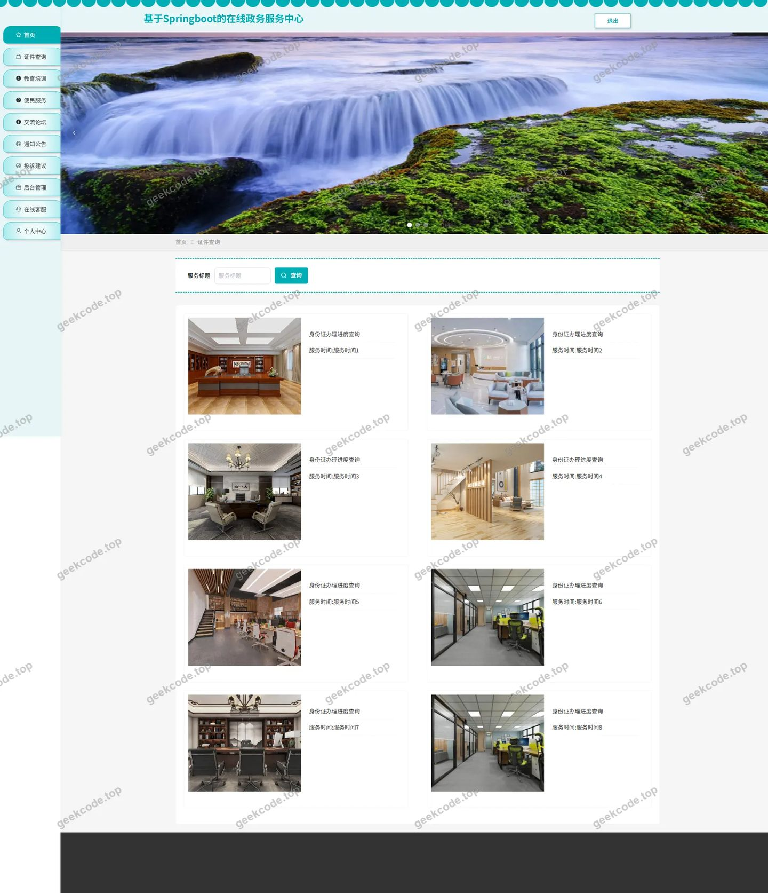</a>

<h4>前台-个人中心</h4>

<a href="https://geekcode.top/archives/%E5%9F%BA%E4%BA%8ESpringboot%E7%9A%84%E5%9C%A8%E7%BA%BF%E6%94%BF%E5%8A%A1%E6%9C%8D%E5%8A%A1%E4%B8%AD%E5%BF%83-%E8%AE%BA%E6%96%87?utm_source=github" title="查看完整源码">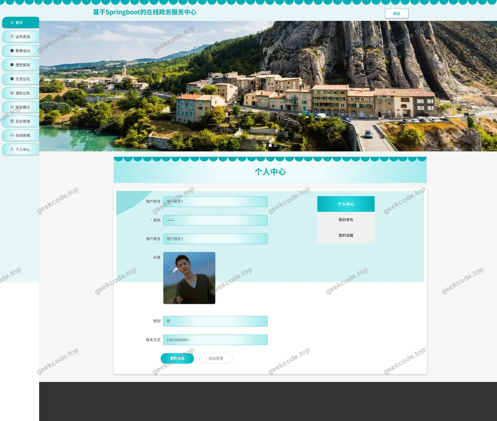</a>

<h4>前台-公告列表</h4>

<a href="https://geekcode.top/archives/%E5%9F%BA%E4%BA%8ESpringboot%E7%9A%84%E5%9C%A8%E7%BA%BF%E6%94%BF%E5%8A%A1%E6%9C%8D%E5%8A%A1%E4%B8%AD%E5%BF%83-%E8%AE%BA%E6%96%87?utm_source=github" title="查看完整源码">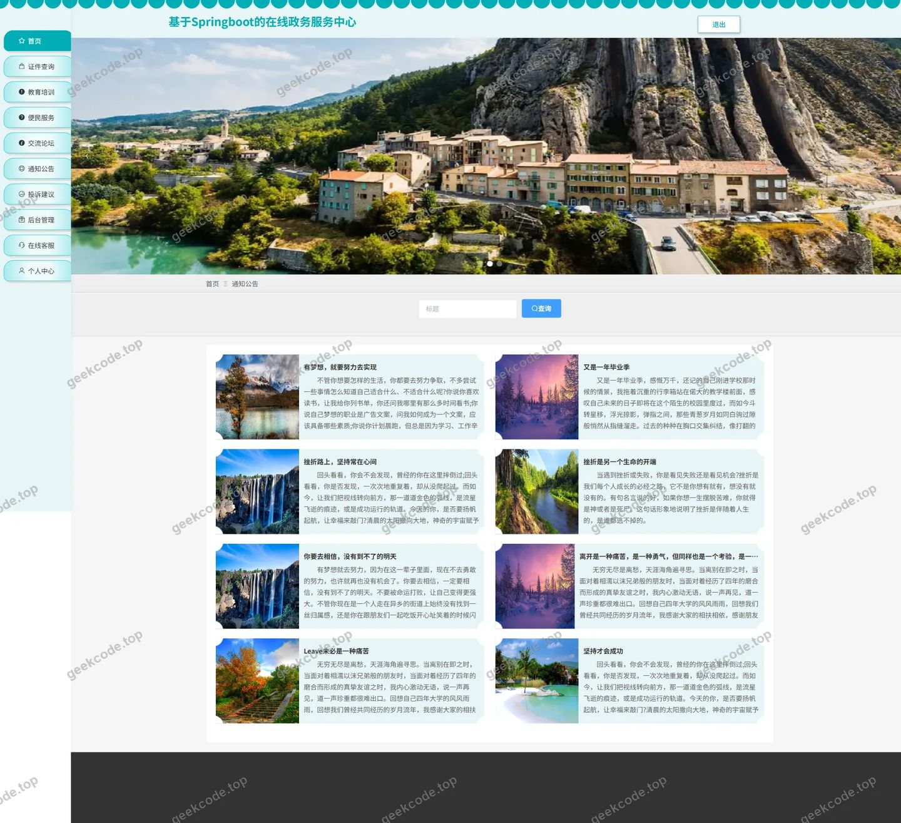</a>

<h3>后台管理端</h3>
<h4>后台-关于我们</h4>

<a href="https://geekcode.top/archives/%E5%9F%BA%E4%BA%8ESpringboot%E7%9A%84%E5%9C%A8%E7%BA%BF%E6%94%BF%E5%8A%A1%E6%9C%8D%E5%8A%A1%E4%B8%AD%E5%BF%83-%E8%AE%BA%E6%96%87?utm_source=github" title="查看完整源码">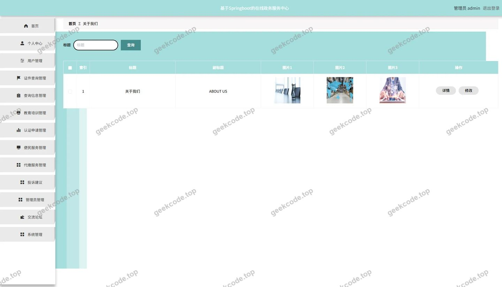</a>

<h4>后台-便民服务</h4>

<a href="https://geekcode.top/archives/%E5%9F%BA%E4%BA%8ESpringboot%E7%9A%84%E5%9C%A8%E7%BA%BF%E6%94%BF%E5%8A%A1%E6%9C%8D%E5%8A%A1%E4%B8%AD%E5%BF%83-%E8%AE%BA%E6%96%87?utm_source=github" title="查看完整源码">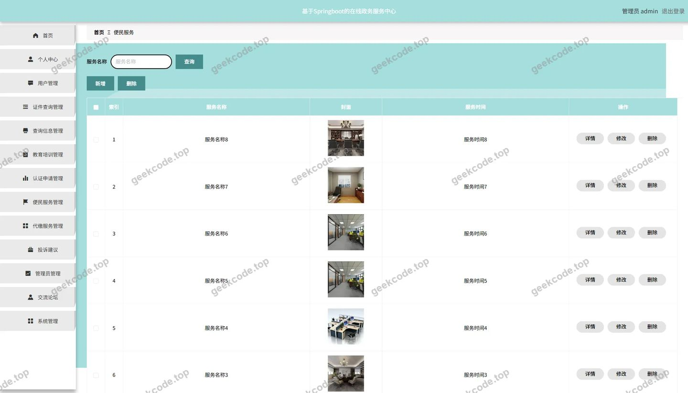</a>

<h4>后台-在线客服</h4>

<a href="https://geekcode.top/archives/%E5%9F%BA%E4%BA%8ESpringboot%E7%9A%84%E5%9C%A8%E7%BA%BF%E6%94%BF%E5%8A%A1%E6%9C%8D%E5%8A%A1%E4%B8%AD%E5%BF%83-%E8%AE%BA%E6%96%87?utm_source=github" title="查看完整源码">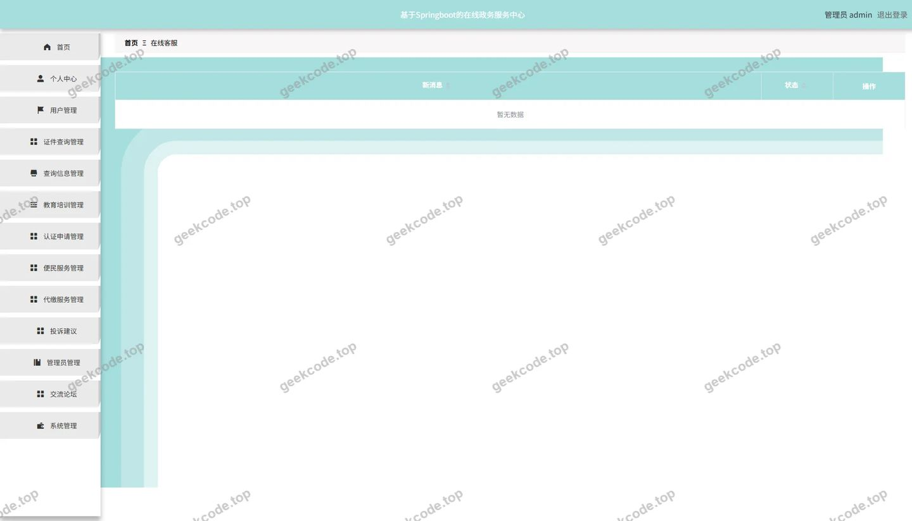</a>

<h4>后台-查询信息</h4>

<a href="https://geekcode.top/archives/%E5%9F%BA%E4%BA%8ESpringboot%E7%9A%84%E5%9C%A8%E7%BA%BF%E6%94%BF%E5%8A%A1%E6%9C%8D%E5%8A%A1%E4%B8%AD%E5%BF%83-%E8%AE%BA%E6%96%87?utm_source=github" title="查看完整源码">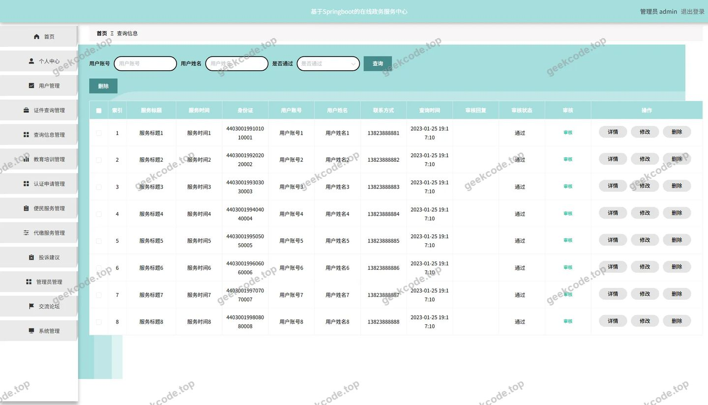</a>

<h4>后台-系统配置</h4>

<a href="https://geekcode.top/archives/%E5%9F%BA%E4%BA%8ESpringboot%E7%9A%84%E5%9C%A8%E7%BA%BF%E6%94%BF%E5%8A%A1%E6%9C%8D%E5%8A%A1%E4%B8%AD%E5%BF%83-%E8%AE%BA%E6%96%87?utm_source=github" title="查看完整源码">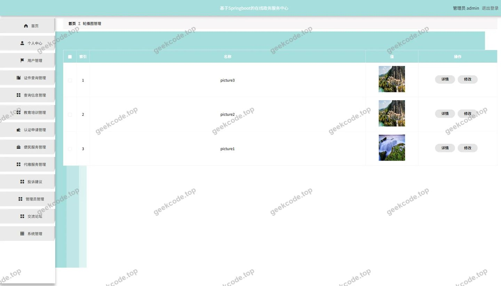</a>

<h4>后台-代缴服务</h4>

<a href="https://geekcode.top/archives/%E5%9F%BA%E4%BA%8ESpringboot%E7%9A%84%E5%9C%A8%E7%BA%BF%E6%94%BF%E5%8A%A1%E6%9C%8D%E5%8A%A1%E4%B8%AD%E5%BF%83-%E8%AE%BA%E6%96%87?utm_source=github" title="查看完整源码">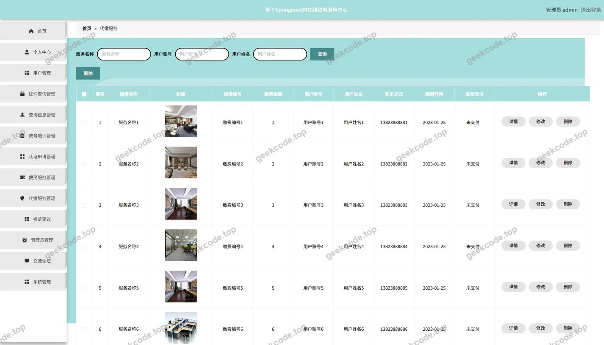</a>

<h4>后台-论坛</h4>

<a href="https://geekcode.top/archives/%E5%9F%BA%E4%BA%8ESpringboot%E7%9A%84%E5%9C%A8%E7%BA%BF%E6%94%BF%E5%8A%A1%E6%9C%8D%E5%8A%A1%E4%B8%AD%E5%BF%83-%E8%AE%BA%E6%96%87?utm_source=github" title="查看完整源码">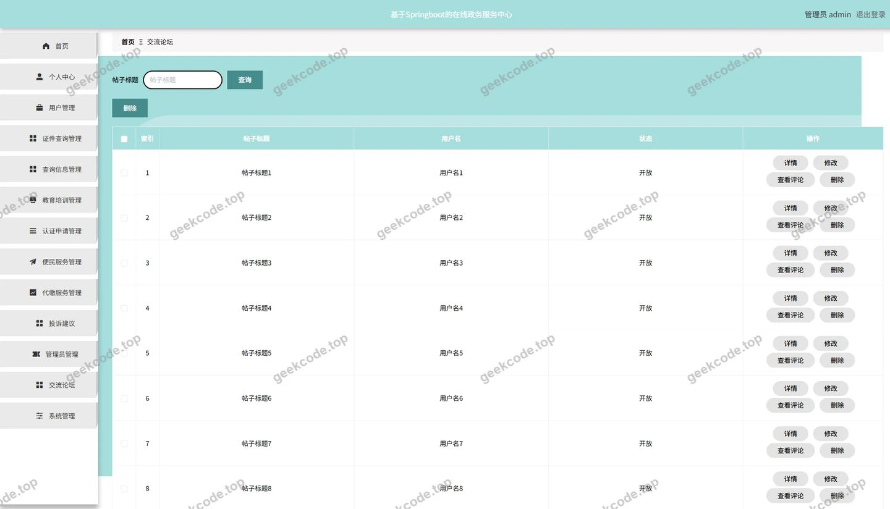</a>

<h4>后台首页</h4>

<a href="https://geekcode.top/archives/%E5%9F%BA%E4%BA%8ESpringboot%E7%9A%84%E5%9C%A8%E7%BA%BF%E6%94%BF%E5%8A%A1%E6%9C%8D%E5%8A%A1%E4%B8%AD%E5%BF%83-%E8%AE%BA%E6%96%87?utm_source=github" title="查看完整源码">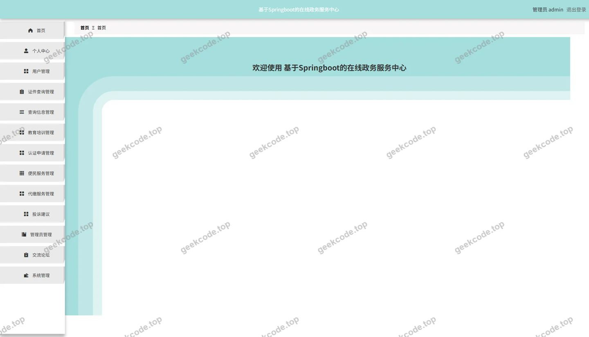</a>

<h4>后台-教育培训</h4>

<a href="https://geekcode.top/archives/%E5%9F%BA%E4%BA%8ESpringboot%E7%9A%84%E5%9C%A8%E7%BA%BF%E6%94%BF%E5%8A%A1%E6%9C%8D%E5%8A%A1%E4%B8%AD%E5%BF%83-%E8%AE%BA%E6%96%87?utm_source=github" title="查看完整源码">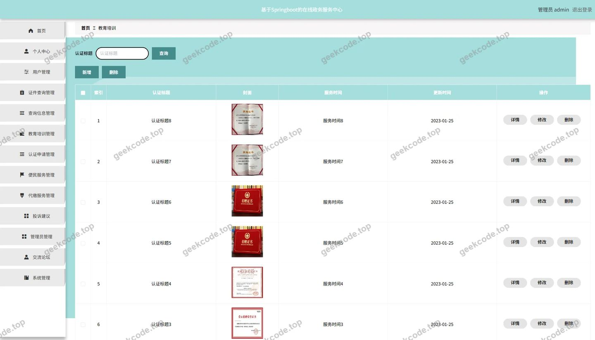</a>

<h4>后台-登录</h4>

<a href="https://geekcode.top/archives/%E5%9F%BA%E4%BA%8ESpringboot%E7%9A%84%E5%9C%A8%E7%BA%BF%E6%94%BF%E5%8A%A1%E6%9C%8D%E5%8A%A1%E4%B8%AD%E5%BF%83-%E8%AE%BA%E6%96%87?utm_source=github" title="查看完整源码">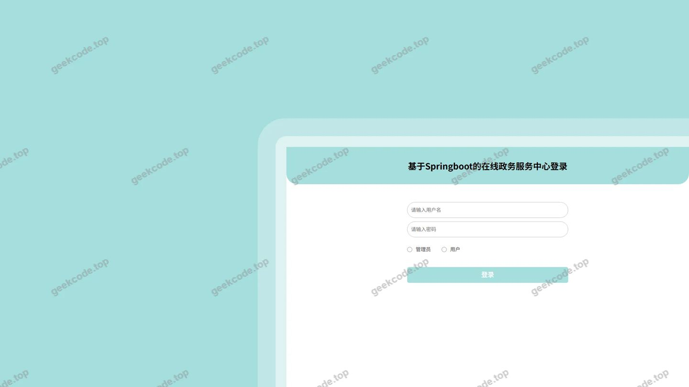</a>

<h4>后台-留言板</h4>

<a href="https://geekcode.top/archives/%E5%9F%BA%E4%BA%8ESpringboot%E7%9A%84%E5%9C%A8%E7%BA%BF%E6%94%BF%E5%8A%A1%E6%9C%8D%E5%8A%A1%E4%B8%AD%E5%BF%83-%E8%AE%BA%E6%96%87?utm_source=github" title="查看完整源码">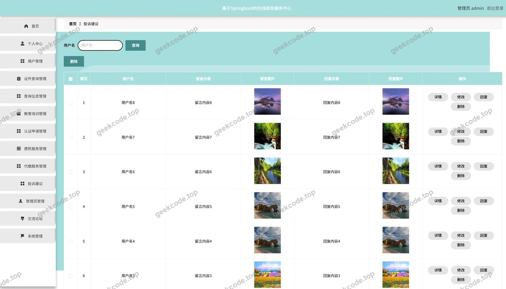</a>

<h4>后台-公告信息</h4>

<a href="https://geekcode.top/archives/%E5%9F%BA%E4%BA%8ESpringboot%E7%9A%84%E5%9C%A8%E7%BA%BF%E6%94%BF%E5%8A%A1%E6%9C%8D%E5%8A%A1%E4%B8%AD%E5%BF%83-%E8%AE%BA%E6%96%87?utm_source=github" title="查看完整源码">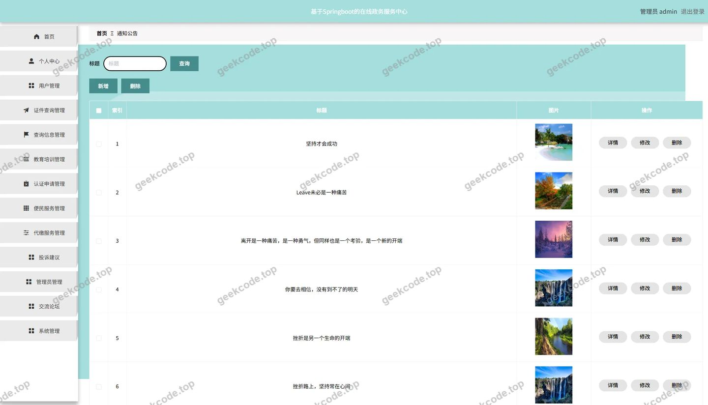</a>

<h4>后台-认证申请</h4>

<a href="https://geekcode.top/archives/%E5%9F%BA%E4%BA%8ESpringboot%E7%9A%84%E5%9C%A8%E7%BA%BF%E6%94%BF%E5%8A%A1%E6%9C%8D%E5%8A%A1%E4%B8%AD%E5%BF%83-%E8%AE%BA%E6%96%87?utm_source=github" title="查看完整源码">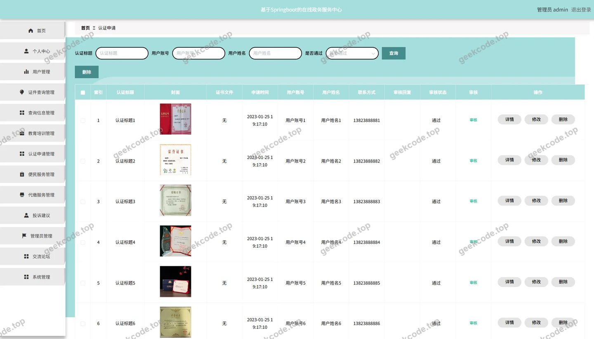</a>

<h4>后台-证件查询</h4>

<a href="https://geekcode.top/archives/%E5%9F%BA%E4%BA%8ESpringboot%E7%9A%84%E5%9C%A8%E7%BA%BF%E6%94%BF%E5%8A%A1%E6%9C%8D%E5%8A%A1%E4%B8%AD%E5%BF%83-%E8%AE%BA%E6%96%87?utm_source=github" title="查看完整源码">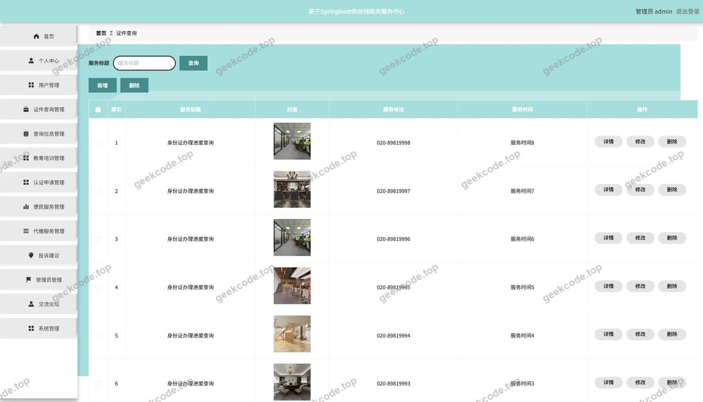</a>

---

## 获取完整源码

| 项目 | 说明 |
| --- | --- |
| 项目名 | 基于Springboot的在线政务服务中心--论文 |
| 运行截图 | 本文 26 张（站点带水印原图，仓库 `images/` 目录） |
| 完整源码 | [https://geekcode.top/archives/%E5%9F%BA%E4%BA%8ESpringboot%E7%9A%84%E5%9C%A8%E7%BA%BF%E6%94%BF%E5%8A%A1%E6%9C%8D%E5%8A%A1%E4%B8%AD%E5%BF%83-%E8%AE%BA%E6%96%87?utm_source=github](https://geekcode.top/archives/%E5%9F%BA%E4%BA%8ESpringboot%E7%9A%84%E5%9C%A8%E7%BA%BF%E6%94%BF%E5%8A%A1%E6%9C%8D%E5%8A%A1%E4%B8%AD%E5%BF%83-%E8%AE%BA%E6%96%87?utm_source=github) |
| 咨询微信 | **ir9372**（备注：jingpin-yuanma） |
| 更多项目 | [极客代码 geekcode.top](https://geekcode.top/?utm_source=github) |

> 需要源码、部署、改配置、跑不起来等问题，加微信 ir9372 沟通，说明项目名即可。
